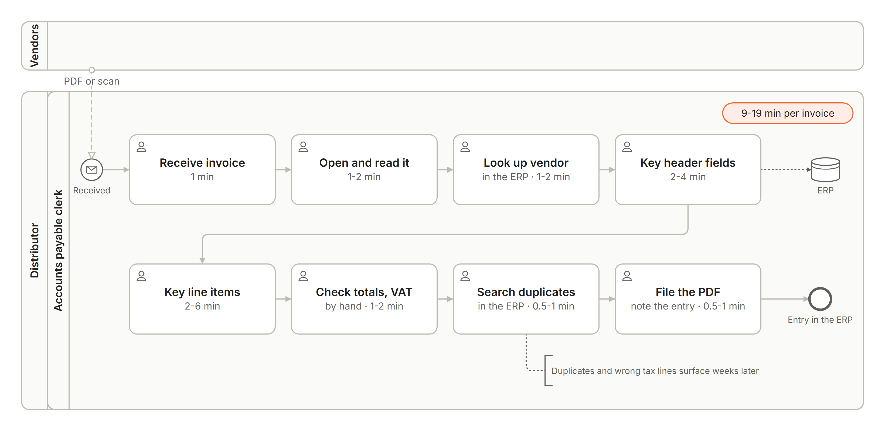
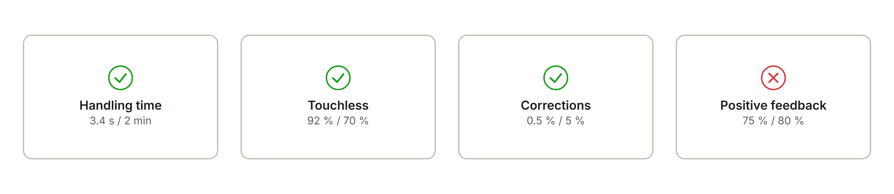
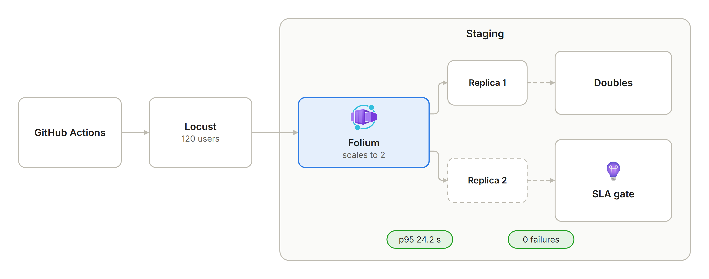
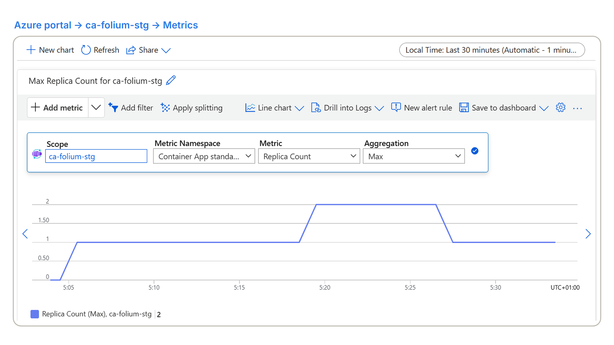

# <picture><source media="(prefers-color-scheme: dark)" srcset="docs/images/brand/folium-logo-white.png"></picture>

Built by **Rodrigo Martín Gómez del Moral Herranz**

&nbsp;&nbsp;&nbsp;&nbsp;

Folium is an AI product on Azure for the accounts payable team of a Spanish wholesale distributor, which keys its supplier
invoices by hand, 1,500 a month at 9 to 19 minutes each: it reads every field with its confidence and its place on the page,
validates Spanish taxes and blocks duplicates, then leaves a review card on which a person decides every invoice, and nothing is
exported twice. In production, 95 % of standard invoices were ready for review within 20.4 s (75 invoices, 2026-11-03 to
2026-11-08, synthetic use), and the staging load test of `v1.0.5` kept that 95th percentile (p95) at 24.2 s over 240 invoices,
against the 30 s committed in the SLA (2026-11-08).

**Live demo:** <https://rodrigo-gomezdelmoral.github.io/product-finance-folium/> - runs recorded from staging, replayed with their real timings and no backend.

> **All data is synthetic.** The invoices come from [`ops/make_invoices.py`](ops/make_invoices.py), and the client's volumes
> and times are the product brief's ([`docs/PRODUCT.md`](docs/PRODUCT.md)). Production's figures come from the author's
> walk-through, a scripted browser and the demo recording, not from clerks' work.

Production, 2026-11-08: a batch of three invoices uploaded in one message, and the first card ready for review in 15.4 s, with
each field's value, confidence and page next to the original.

## The problem

A mid-size Spanish wholesale distributor receives about 1,500 invoices a month from about 400 vendors, as PDFs and scans, with a
month-end peak of about 150 a day. Three clerks key every one of them into the ERP: read it, look up the vendor, key the header
and the lines, check the totals and VAT by hand, search for a duplicate and file the PDF. That is 225 to 475 hours a month, and
the mistakes it lets through, an invoice entered twice or a wrong tax line, surface only at reconciliation, when the payment run
or the VAT return is already at risk. What the client buys is time back for the clerks, errors caught before the ERP instead of
weeks after it, and a record of who decided what on every invoice.

## What it does

- **Reads each invoice.** Document Intelligence extracts every field, and Folium keeps its confidence and the place on the page it
  came from.
- **Normalises it and matches the vendor.** One schema for every invoice; a model is called only where a rule cannot decide, and
  any value the model did not read in the document is rejected.
- **Validates taxes and blocks duplicates.** Spanish VAT and IRPF (income tax withheld) rates, tax IDs, dates and arithmetic, and
  exact and probable duplicates.
- **Keeps a person on every invoice.** The original sits next to the fields for the clerk; invoices with a finding (a failed check)
  or a duplicate go to the accounting lead, and the AI never approves or exports.
- **Exports exactly once.** Approved invoices leave in the ERP layout, with a timeline of every step and decision.

The clerk's work per invoice becomes the review of a prepared card, with a target of 2 minutes instead of 9 to 19: at the
client's volume, 225 to 475 hours a month would become about 50. That is the target; the handling time of real clerks is not
measured yet ([KPIs](#kpis)).

## Requirements

Status on 2026-11-10: every Must is implemented, tested, used in staging and met in production on `v1.0.5`, released on
2026-11-08 and recorded the same day through the production web. Production has run since `v1.0.1` (2026-11-02); `v1.0.0`
stopped before production. The acceptance criteria are in [`docs/PRODUCT.md`](docs/PRODUCT.md), and the open limitations, each
with its figure and date, in [Known limitations](docs/OPERATIONS.md#known-limitations).

Each "take N" on the board is the numbered take of the demo video, recorded in production on 2026-11-08, that shows the
requirement; what each step of that recording did is in [Recording in production](docs/OPERATIONS.md#recording-in-production).

| REQ | Must | Staging | Production | Evidence |
|---|---|---|---|---|
| REQ-01 | Upload one invoice or a batch of up to 20 | done | met | `test_upload_batch_hash_and_types`; on 2026-11-08 the production web took a batch of three (PDF, PDF, JPEG), ready in 13.9 to 15.4 s, and refused a text file with `415` (takes 14 and 13) |
| REQ-02 | Extract every field with its confidence and source | done | met | `test_extract_maps_all_fields` on recorded responses; header accuracy 0.9937 in the evaluation (2026-10-31); each field on the card with its confidence and page (take 15) |
| REQ-03 | Normalise to the canonical schema and match the vendor | done | met | `test_normalizer_cross_check_rejects_invented_values`: the model cannot add a value absent from the document; every invoice of the production walk-through matched the seeded 40-vendor master (2026-11-03); the matched vendor on the card in take 15 |
| REQ-04 | Validate mandatory fields, arithmetic, tax rates, tax IDs and dates | done | met | `test_rules_type_each_failure_with_its_evidence`, `test_rules_check_nif_cif_and_eu_vat`; finding precision and recall 1.00 in the evaluation; a total that does not add up sent to the lead and rejected, through the API on 2026-11-03 and through the web on 2026-11-08 (take 17) |
| REQ-05 | Detect exact and probable duplicates | done | met | `test_duplicates_exact_and_probable`, `test_duplicate_blocks_export`; duplicate precision and recall 1.00 in the evaluation; a probable duplicate blocked, sent to the lead and rejected, on 2026-11-03 and in take 18 |
| REQ-06 | Review and correct, with every correction recorded | done | met | `test_correction_recorded`, `test_clerk_cannot_approve_findings`; 2 corrections through the production web on 2026-11-08, each in the timeline and as a `field_corrected` event (takes 16 and 21) |
| REQ-07 | Export approved invoices exactly once in the ERP layout | done | met | `test_export_exactly_once`; on 2026-11-03 the same `Idempotency-Key` twice returned one batch and a third export found nothing left; on 2026-11-08 five approved invoices left in one batch and a second export found nothing left (take 20) |
| REQ-08 | Full traceability per invoice | done | met | `test_timeline_complete`, `test_resume_from_checkpoint`, `test_redelivered_message_is_a_noop`; the timeline in [In action](#in-action), from upload to approval with the model and prompt versions (take 21) |
| REQ-10 · SLA | 99.5 % availability in business hours | met under load | met, synthetic use | the SLA table below |
| REQ-11 · SLA | 95 % of standard invoices ready for review in under 30 s | met under load | met, synthetic use | the SLA table below |

Of the two Shoulds, REQ-09, a read-only assistant with cited answers, is met: `test_assistant_has_no_write_tool`, groundedness 4.2
to 4.65 on a 1 to 5 scale and citations 1.00 in the evaluation (2026-10-31), and cited answers in production (take 22). One gap is
documented in [Known limitations](docs/OPERATIONS.md#known-limitations): it reads "waiting for approval" as waiting for the lead,
not for the clerk's review. REQ-12, erasure of a sole trader's personal data, is implemented and tested
(`test_erase_redacts_personal_fields`) but has not run live.

The SLAs are what is committed to the client, each with a stricter internal target, its SLO; both are read in Application
Insights:

| SLA | Committed | Staging, the load test of 2026-11-08 on `v1.0.5`'s commit | Production, 2026-11-03 to 2026-11-08 (synthetic use) |
|---|---|---|---|
| REQ-10 Availability | 99.5 % in business hours over a calendar month (SLO 99.7 %) | 100 %: no server error over normal, peak and soak | 100 %: 0 server errors in 32,261 business-hours request records, health probes included (business hours of 2026-11-03 to 2026-11-06; the recording of 2026-11-08 fell on a Sunday, outside them) |
| REQ-11 Ready for review | p95 under 30 s for standard invoices over a calendar month (SLO 25 s) | 24.2 s over 240 invoices | 20.4 s over 75 standard invoices |

## KPIs

Read on 2026-11-10 with the workbook's queries on production's Application Insights `customEvents`, which are never sampled
out, over 2026-11-03 to 2026-11-08. That is **synthetic use**: the author's walk-through and rehearsal (2026-11-03), a scripted
browser that seeds a week of use through the web (2026-11-06 and 2026-11-08) and the demo recording (2026-11-08).

| KPI | Target | Measured in production | Cases |
|---|---|---|---|
| Handling time per invoice | 2 min or less, from 9 to 19 today | median 3.4 s | 43 approvals through the web; the API sends no review time |
| Touchless rate | 70 % or more approved with no correction | 92 % | 44 of 48 approvals |
| Field correction rate | 5 % or less of extracted fields | 0.48 % | 4 corrected of 842 fields on approved invoices |
| Positive feedback | 80 % or more | **75 %**, missed | 18 of 24 votes |

The handling time is mostly the scripted browser's, which approves in seconds; the recording's three batch approvals took 318 to
335 s, because the cards stayed open during the takes. It shows the measurement works, not a clerk's time. The 6 unhelpful votes
all come from the scripted week; the walk-through's and the recording's 3 votes were helpful.

## Repo card

| | |
|---|---|
| **Type** | AI product: accounts payable invoice processing for a mid-size wholesale distributor |
| **Client and users** | the accounts payable team of a Spanish wholesale distributor: clerks upload and review (`Invoice.Process`), the accounting lead decides findings and duplicates and exports (`Invoice.Approve`) |
| **Azure services** | per environment: Container Apps with built-in Entra sign-in, Cosmos DB for NoSQL serverless, Blob Storage, Service Bus Basic, Application Insights with a KPI and SLA workbook, a budget; in production also four alert rules and an action group. Shared: Foundry (`gpt-5-mini`, Document Intelligence, Prompt Shields), Container Registry, Log Analytics. Both apps run in Folium's one Container Apps environment |
| **AI** | Document Intelligence `prebuilt-invoice`; `gpt-5-mini` 2025-08-07, pinned; Microsoft Agent Framework: a graph workflow per invoice with checkpoints and human review, one normaliser agent and a read-only assistant, self-hosted; Prompt Shields on every document |
| **Stack** | Python 3.12, FastAPI, Agent Framework; React, TypeScript and Vite in the common product interface, WCAG 2.2 AA (axe on every pull request; Lighthouse accessibility 100 on the demo build, 2026-11-03) |
| **Environments and delivery** | local with emulators; staging on every merge and production on every release, one image per merge deployed by digest; GitHub Actions with OIDC, no secrets; current release `v1.0.5` (2026-11-08) |
| **Security** | managed identities and local auth off everywhere, built-in sign-in with app roles, HTTPS only, Prompt Shields on every document, no write tool for any model |
| **SLA** | availability 99.5 % in business hours and p95 ready under 30 s; measured: 100 % and 24.2 s over 240 invoices in the staging load test of `v1.0.5`'s commit (2026-11-08), 100 % and 20.4 s over 75 standard invoices in production (2026-11-03 to 2026-11-08, synthetic use) |
| **Demo** | <https://rodrigo-gomezdelmoral.github.io/product-finance-folium/> |

## Architecture

One container app serves the web client and the API and runs the queue consumer. An upload is stored in Blob Storage and
Cosmos DB and queued in Service Bus; the consumer runs the invoice's workflow and saves its checkpoints in Cosmos DB, so a
review resumes it on any replica. KEDA, the Container Apps autoscaler, scales the app on HTTP requests and on the queue, from
zero. Staging and production run their own apps in Folium's one Container Apps environment, `cae-folium-env` in `italynorth`,
which lives in production's resource group; data, telemetry and the shared AI services are in `swedencentral`, where the
subscription's Container Apps environment quota was already taken
([ADR-013](docs/adr/013-one-container-apps-environment-per-product.md)).

## How it works

### One workflow per invoice

### A function before an agent

The rules, the duplicate check, the vendor match and the export are plain functions. The one agent fills only what the
extraction could not read, and every value it proposes must be printed in the document
([ADR-002](docs/adr/002-one-agent-where-a-function-cannot.md)). Prompt Shields, Azure's detector of instructions hidden in a
document, checks every invoice before the agent; an invoice it flags skips the agent and goes to the lead with a
`possible_injection` finding.

### Human in the loop by construction

The workflow pauses with a review request; only a person's decision resumes it, from its checkpoint, exactly once. A clerk
cannot approve an invoice with an open finding or a duplicate, and no model has a tool that writes
([ADR-001](docs/adr/001-graph-workflow.md)).

### Evaluation gate

Every pull request that touches the agents, prompts or workflow runs the smoke suite, a short evaluation that fails the pull
request when a metric misses its threshold or drops below its recorded baseline. On 2026-10-31 the full suite passed every gate:
header fields 0.9937, line items 0.9186, findings and duplicates 1.00 precision and recall, injection effect 0 (no invoice with
planted instructions changed a field or left review without a person), groundedness 4.43 on a 1 to 5 scale (mean of four runs)
and citations 1.00 ([`docs/evaluation.md`](docs/evaluation.md)).

## In action

Recorded in production on 2026-11-08, on `v1.0.5`, through the web (17:47 to 18:22 UTC):

- **A batch, ready for review** (the image at the top): three invoices ready in 13.9 to 15.4 s; six more uploads ready in 8.3
  to 12.5 s.
- **A file that is not an invoice:** refused with `415` before any processing.
- **Every field with its source:** the card shows each field's confidence and page next to the original.
- **A correction, recorded:** a field corrected and the invoice approved; the timeline below keeps the value before and after.
- **Findings go to the lead:** a total that does not add up waits for the accounting lead, who rejects it with a reason.
- **A probable duplicate:** same vendor and total within 7 days of an approved invoice, sent to the lead and rejected.
- **Hidden instructions in an invoice:** Prompt Shields flags `Possible injection`, the model never reads the invoice, and the
  lead rejects it.
- **Export exactly once:** five approved invoices left in one batch, and a second export found nothing left.
- **Ask the invoices:** the assistant's answer cites the invoices it used.

The [published demo](https://rodrigo-gomezdelmoral.github.io/product-finance-folium/) replays the same journeys, recorded
from staging by [`ops/record.py`](ops/record.py). Lighthouse 12.8.2 scores it 100 for accessibility (mobile, 2026-11-03), and
every pull request runs axe on the demo build, failing on any serious or critical WCAG 2.2 AA violation.

![The web's timeline of the invoice uploaded as inv-026.pdf, dates as day/month/year in Madrid time: on 8/11/2026, uploaded at 17:01:48, extracted with prebuilt-invoice API 2024-11-30, shielded with no attack, normalised by gpt-5-mini-2025-08-07 with prompt normalizer_v2 filling the tax lines, validated with no finding, deduplicated with no duplicate and ready for review at 17:02:03; at 19:19:53 its due date corrected from 2026-06-13 to 2026-07-13 and the invoice approved, with the original's SHA-256 below](docs/images/timeline.png)

## Environments and releases

- **Image:** built once per merge (`<yyyymmdd>-main-<sha7>`) and deployed to staging by digest behind a canary label, with a
  health check and a smoke test.
- **Release:** `release.yml` checks that the tag's commit was deployed to staging and passed the load test (not needed when
  only the web, docs or workflows changed since the last release in production,
  [ADR-014](docs/adr/014-release-without-load-test-for-web-only-changes.md)), then, after the author's approval,
  promotes the same digest: 10 % of traffic for ten minutes watching server errors, then 100 %, or a rollback. `v1.0.5`'s
  release run took 16 min 32 s on 2026-11-08, approval and canary included; staging and production now run the same image.
- **Rollback:** a release of an earlier tag, from `v1.0.1` on, or the inactive previous revision. Rehearsed in staging on
  2026-11-03: to `v1.0.3`'s image in 192 s and back to `v1.0.4`'s in 188 s
  ([`docs/OPERATIONS.md`](docs/OPERATIONS.md#rollback)).

### Load tests

`load-test.yml` redeploys the staging digest as a revision where Document Intelligence and the model are replaced by doubles,
stand-ins that answer with the real services' measured latencies; it runs normal, peak, soak and stress, restores the stable
revision and sends 20 invoices through the real services. REQ-10 and REQ-11 are read in Application Insights over normal, peak
and soak, and set the `load-test` commit status that a release requires.

Run 42498718441 on 2026-11-08, 16:13 to 17:09 UTC, on commit `8d7b7d2`, released as `v1.0.5`. p50, p95 and p99 are Locust's
time from the upload until the review card is ready; replicas are Azure Monitor's per-minute maximum during each scenario.
Requests are Locust's entries: the uploads, the status reads that poll each invoice every 2 s and one entry per invoice when it
is ready; Requests/s and Errors count all three.

| Scenario | Load | p50 | p95 | p99 | Requests/s | Errors | Replicas |
|---|---|---|---|---|---|---|---|
| normal | 5 users, one invoice a minute each, 5 min | 16 s | 22 s | 22 s | 0.87 | 0 of 222 requests, 0 of 25 uploads | 1 |
| peak | three 20-invoice batches, 5 min | 25 s | 44 s | 44 s | 3.18 | 0 of 338 requests, 0 of 3 uploads | 1, then 2 |
| soak | the normal rate for 30 min | 16 s | 18 s | 18 s | 0.75 | 0 of 1,324 requests, 0 of 150 uploads | 2, then 1 |
| stress | 10 more users a minute, to about 100 in 10 min | 16 s | 27 s | 29 s | 9.02 | 0 of 5,589 requests, 0 of 594 uploads | 1, then 2 |
| real services | one 20-invoice batch | 43 s | 47 s | 47 s | 2.58 | 0 of 120 requests, 0 of 1 upload | 2 |

For the gate, the workflow counts the standard invoices that reached `invoice_ready` in Application Insights from the start of
the run to the end of the soak: 240, the 235 that Locust counted in normal, peak and soak (25 + 60 + 150) and 5 that normal's
users sent as Locust stopped them, which the app processed but Locust did not record. Their p95 ready time, over the three
scenarios together and not per row of the table, is 24.2 s against an SLO of 25 s and an SLA of 30 s, and availability is
100 % against 99.7 % and 99.5 %, over all hours of the three scenarios. Peak CPU 0.22 of 0.5 vCPU, memory 0.46 GB, queue 23
messages.

No invoice failed: all 859 invoices uploaded during the run reached `invoice_ready`, the 849 that Locust counted
(25 + 60 + 150 + 594 + 20) and 10 that normal's and soak's users sent as Locust stopped them. The run's metrics step reads 2
dead-lettered messages (set aside by Service Bus after repeated failed deliveries); they are the two that run 1 dead-lettered
on 2026-11-01, still in staging's dead-letter queue, which keeps messages until they are removed. The metric counts the queue,
not new arrivals: its hourly maximum has been 2 since 2026-11-01 ([`docs/OPERATIONS.md`](docs/OPERATIONS.md#load-tests)).

Batches alone are slower than the month: a month-end batch on its own has a p95 of 44 s on staging's two replicas; REQ-11 is a
monthly p95, and production allows three replicas and keeps one warm in business hours
([ADR-011](docs/adr/011-scale-to-zero-and-cold-start.md)). The earlier gates gave 24.2 s and 100 % on 2026-11-02 (run
41494700777, `v1.0.1`) and 25.6 s and 100 % on 2026-11-03 (run 41609663316, `v1.0.4`), above the 25 s SLO and under the 30 s
SLA, with stress at 0 of 4,945 requests failed at 8.39 a second.

### SLOs and DORA

- **SLOs:** p95 ready 24.2 s against an SLO of 25 s in the load test and 20.4 s in production; availability 100 % against
  99.7 % in both. Cold start, the first request after the app scaled to zero, on `cae-folium-env`: 34.9 s in production and
  35.8 s in staging (2026-11-02), 33.0 s in staging with `v1.0.4`'s image (2026-11-03), one request each. Restore drill:
  Cosmos DB point-in-time restore in 11 minutes, a blob version in 13 s (2026-11-01).
- **DORA**, the four delivery metrics of the DevOps Research and Assessment program, from the GitHub Actions runs, read on
  2026-11-10 ([`docs/OPERATIONS.md`](docs/OPERATIONS.md#dora-metrics)):

| Metric | Staging, 2026-10-31 to 2026-11-03 | Production, 2026-11-02 to 2026-11-08 |
|---|---|---|
| Deployment frequency | 13 deployment runs on merges (2 of them failed, below), plus 2 dispatched for the rollback drill | 5 successful releases in 7 days, `v1.0.1` to `v1.0.5` |
| Lead time for changes | 3 min 50 s to 4 min 28 s from a merge to staging, the last five merges | 20 min for `v1.0.2` and `v1.0.3`, 1 h 23 min for `v1.0.1` and 1 h 32 min for `v1.0.4` (its one-hour load test included), from the merge; `v1.0.5` was held for the demo recording, and its release run took 16 min 32 s |
| Change failure rate | 2 of 13 deployments failed (15 %), both on 2026-10-31 | 1 of 6 release runs (17 %): `v1.0.0` failed before production; no release has been rolled back |
| Time to restore | 10 h 28 min, overnight, to the next successful deployment | 9 h 46 min, from `v1.0.0`'s failure to `v1.0.1`'s success |

## Cost

EUR a month, from the Retail Prices API on 2026-10-30 and 2026-10-31 ([`docs/cost.md`](docs/cost.md)). *In use* is the
month's total with that use, the at-rest costs included; production's 3 was estimated before the business-hours replica, which
adds 3 to 4 in both columns.

| | Staging | Production |
|---|---|---|
| At rest | about 0.3 | about 1.5, plus 3 to 4 for the business-hours replica |
| In use | about 7, with evaluation, load tests and real-service runs | about 3 with demo use, plus 3 to 4 for the business-hours replica |
| Budget | 10 | 20 |

At the client's volume, 1,500 invoices and 3,000 pages a month, the estimate is about 38 € a month, about 0.025 € per invoice,
against 3 to 8 € of manual work per invoice. Document Intelligence is 26.4 € of it, `gpt-5-mini` about 5.3 € and Container
Apps about 4 €. The estimate is compared with Cost Management per environment after a month of use.

## Well-Architected design

| Pillar | Applied | Trade-off accepted |
|---|---|---|
| Reliability | one queue with a dead-letter queue, retries with `Retry-After`, an idempotent consumer, checkpoints, probes, point-in-time restore drilled | no zone redundancy; cold DR, with no standby region: recovery is a redeploy and a restore |
| Security | managed identities, local auth off, built-in sign-in with app roles, Prompt Shields, pinned dependencies and actions | no private endpoints, web application firewall or Defender plans; staging and production share one environment |
| Cost Optimization | scale to zero, serverless Cosmos DB, Service Bus Basic, `max_tokens`, file and batch limits, budgets per environment | one business-hours replica in production for REQ-11 |
| Operational Excellence | Bicep with `what-if`, one image deployed by digest, canary release with rollback, KPI and SLA workbook | one operator |
| Performance Efficiency | KEDA on HTTP and queue, clients built once, vendor master cached | the apps in `italynorth`, the data in `swedencentral` |

## Deploy

Deployment runs only through GitHub Actions: a merge to `main` deploys staging, and a published release
(`gh release create vX.Y.Z`) deploys production after the author approves the `production` environment. Prerequisites: the
shared base (Foundry account and project with `gpt-5-mini`, Container Registry, Log Analytics) and two empty resource groups.

### Bootstrap

`infra/main.bicep` deploys each environment at resource-group scope with `main.staging.bicepparam` or
`main.production.bicepparam`, which read the image digest, the sign-in client id and the revision suffix from the workflow.

### Federated credentials

One Entra application per environment for the CI principal, with federated credentials for the `staging` and `production`
GitHub environments and for pull requests; no client secret anywhere.

### GitHub secrets and variables

- Repository secrets: `AZURE_CLIENT_ID_PR`, `AZURE_TENANT_ID`, `AZURE_SUBSCRIPTION_ID` and `ALERT_EMAIL_ADDRESS`.
- Per environment (`staging`, `production`): the secret `AZURE_CLIENT_ID` and the variables `AUTH_CLIENT_ID`, `RESOURCE_GROUP`
  and `CONTAINER_APP_NAME`.
- Variables: `ACR_NAME`, `SHARED_RESOURCE_GROUP`, `FOUNDRY_ACCOUNT_ENDPOINT`, `FOUNDRY_PROJECT_ENDPOINT` and `FOUNDRY_MODEL`.

### Identities

The CI principals hold Contributor and a Role Based Access Control Administrator role limited to the roles the Bicep assigns.
The app's identity holds data roles on its own Cosmos DB, storage and queue and Cognitive Services User on the shared
account; the scale rule uses a second identity the code cannot use. Sign-in uses one app registration per environment with
the roles `Invoice.Process` and `Invoice.Approve`, assignment required.

## Documentation

- [`docs/PRODUCT.md`](docs/PRODUCT.md): client, process as-is and to-be, requirements with acceptance criteria, KPIs, SLOs and
  the ERP export layout
- [`docs/OPERATIONS.md`](docs/OPERATIONS.md): promotion, rollback, restore, alerts, incidents, load tests, DORA metrics, the
  walk-through and the recording in production, and the known limitations
- [`docs/THREAT_MODEL.md`](docs/THREAT_MODEL.md): assets and trust boundaries, STRIDE threats and residual risks
- [`docs/RESPONSIBLE_AI.md`](docs/RESPONSIBLE_AI.md): the impact assessment: intended uses, stakeholders, fairness, adverse
  impact and data requirements
- [`docs/evaluation.md`](docs/evaluation.md): the evaluation gate, its datasets and results, and experiment 001
- [`docs/cost.md`](docs/cost.md): prices, the estimate per environment and per invoice, and the options declined
- [`docs/adr/`](docs/adr/): the 14 architecture decisions
- [`CHANGELOG.md`](CHANGELOG.md) and the latest release,
  [`v1.0.5`](https://github.com/Rodrigo-GomezdelMoral/product-finance-folium/releases/tag/v1.0.5) (2026-11-08)

## Author

**Rodrigo Martín Gómez del Moral Herranz**

&nbsp;&nbsp;&nbsp;&nbsp;
