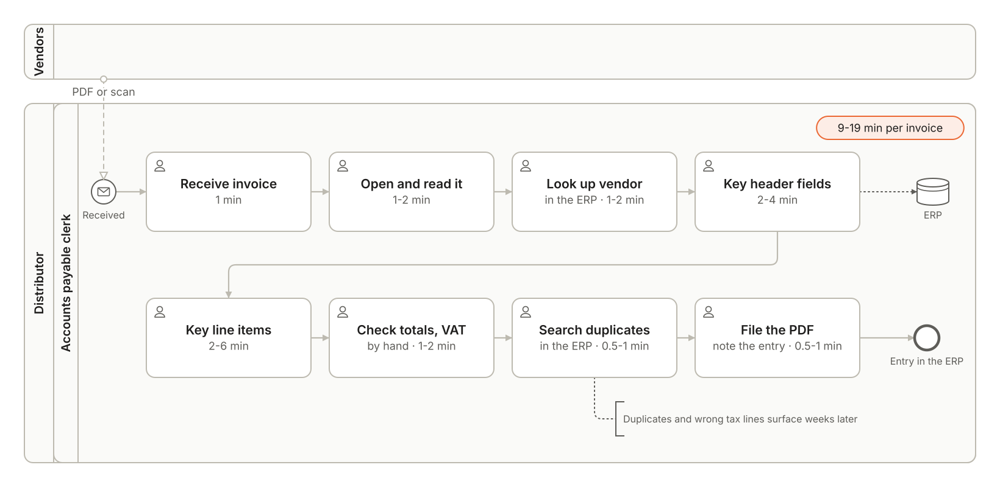
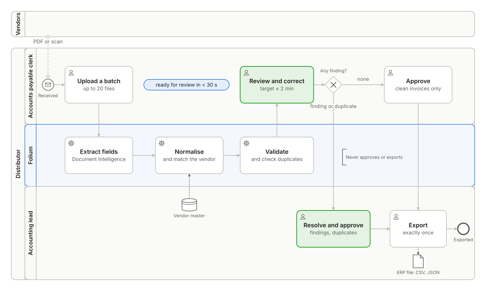

# Folium: product

Folium turns supplier invoices into reviewed, validated and de-duplicated entries ready for the ERP. A model reads what a
deterministic extractor leaves ambiguous; people approve every invoice, and nothing reaches the ERP twice.

## Client

A mid-size Spanish wholesale distributor. Accounts payable is three clerks and one accounting lead. They receive about
**1,500 invoices a month from about 400 vendors**, as PDFs and scans, with a month-end peak of about 150 a day. Every invoice is
keyed by hand into the ERP. Users are employees who sign in with Entra ID, in a single tenant.

## Problem

Today an invoice takes a clerk **9 to 19 minutes**, the sum of the step times the client gave below: **225 to 475 hours a month**
at 1,500 invoices. Duplicates and wrong tax lines still reach the ERP and are found at reconciliation, weeks later, when the
payment run or the VAT return is already at risk.

What the client buys is time back for the clerks, errors caught before the ERP instead of weeks after it, and a record of who
decided what on every invoice.

## Process as-is

One clerk does every step, by hand, for every invoice. The times are the client's.

| # | Step | Who | Time |
|---|---|---|---|
| 1 | Receive the invoice (PDF or scan) | Clerk | 1 min |
| 2 | Open and read it | Clerk | 1-2 min |
| 3 | Look up the vendor in the ERP | Clerk | 1-2 min |
| 4 | Key the header fields | Clerk | 2-4 min |
| 5 | Key the line items | Clerk | 2-6 min |
| 6 | Check totals and VAT by hand | Clerk | 1-2 min |
| 7 | Search the ERP for a duplicate | Clerk | 0.5-1 min |
| 8 | File the PDF and note the entry | Clerk | 0.5-1 min |
| | **Per invoice** | | **9-19 min** |

BPMN 2.0 source: [`images/process-as-is.bpmn`](images/process-as-is.bpmn).

## Process to-be

The clerk uploads a batch. Folium extracts, normalises, validates and checks duplicates, and the invoice is ready for review in
under 30 seconds. The clerk reviews, corrects and approves clean invoices; invoices with findings or duplicates go to the lead,
who resolves them and exports approved invoices in the ERP layout. **Folium never approves and never exports.**

| # | Step | Who | Time |
|---|---|---|---|
| 1 | Upload a batch of up to 20 files | Clerk | |
| 2 | Extract fields with Document Intelligence | Folium | |
| 3 | Normalise to the canonical schema and match the vendor | Folium | steps 2-4: under 30 s (REQ-11) |
| 4 | Validate and check duplicates | Folium | |
| 5 | Review, correct and approve a clean invoice | Clerk | target 2 min or less (handling time KPI) |
| 6 | Resolve findings or duplicates and approve, with a reason | Lead | only invoices with findings |
| 7 | Export approved invoices, exactly once | Lead | per batch |

BPMN 2.0 source: [`images/process-to-be.bpmn`](images/process-to-be.bpmn). Both maps use only the Descriptive conformance
sub-class of BPMN 2.0.2 and validate against the OMG schema.

## Roles

Entra app roles on the `folium-<environment>` app registration.

| Role | Who | Can |
|---|---|---|
| `Invoice.Process` | Clerk | upload, review, correct, approve clean invoices, ask the assistant, give feedback |
| `Invoice.Approve` | Lead | everything a clerk can, plus approve invoices with findings or duplicates, and export |

## Requirements

Must, Should and Won't follow MoSCoW. Each requirement is a user story with its acceptance criteria.

| ID | Priority | Requirement |
|---|---|---|
| REQ-01 | Must | Upload invoices one at a time or in batches |
| REQ-02 | Must | Extract every field with its confidence and source |
| REQ-03 | Must | Normalise to the canonical schema and match the vendor |
| REQ-04 | Must | Validate mandatory fields, arithmetic, tax rates, tax IDs and dates |
| REQ-05 | Must | Detect exact and probable duplicates |
| REQ-06 | Must | Review and correct, with every correction recorded |
| REQ-07 | Must | Export approved invoices exactly once in the ERP layout |
| REQ-08 | Must | Full traceability per invoice |
| REQ-09 | Should | A read-only assistant over the invoices |
| REQ-10 | Must · SLA | 99.5 % monthly availability in business hours |
| REQ-11 | Must · SLA | 95 % of standard invoices ready for review in under 30 s |
| REQ-12 | Should | Erase a sole trader's personal data on request after retention |

### REQ-01 · Upload

*As a clerk, I want to upload one invoice or a batch, so that I stop keying them by hand.*

- **Given** a batch of up to 20 files of PDF, scanned PDF, JPEG or PNG, each 10 MB or less, **when** I upload it, **then** each file
  gets an invoice id, its SHA-256 and the status `queued`, and the response is `202 Accepted`.
- **Given** a file whose SHA-256 matches an invoice already stored, **when** I upload it, **then** it is flagged at once as an exact
  duplicate of that invoice.
- **Given** a file of any other type, **when** I upload it, **then** it is rejected with `415 Unsupported Media Type`; more than 20
  files or a file over 10 MB is rejected with `413 Content Too Large`.

### REQ-02 · Extract

*As a clerk, I want every field read for me, with how sure the system is and where it read it, so that I only check what matters.*

- **Given** a processed invoice, **then** every field of the [canonical schema](#canonical-invoice) has a value or `null`, a
  confidence between 0 and 1, and a source: the page and the bounding region it was read from.
- **Given** a field the document does not contain, **then** its value is `null`, never a guess.

### REQ-03 · Normalise and match the vendor

*As a clerk, I want invoices in one format whatever the vendor's layout, matched to our vendor master.*

- **Given** dates in any common format, decimals with a comma or a point, EUR or another currency, and Spanish or English labels,
  **then** the canonical invoice has ISO 8601 dates, decimal amounts and an ISO 4217 currency code.
- **Given** a vendor tax ID found in the vendor master, **then** the invoice is matched to that vendor; **given** no tax ID match,
  **then** it is matched by name; **given** neither, **then** an `unknown_vendor` finding is raised.
- **Given** a value the model proposes that does not appear in the document's extracted content, **then** it is rejected and a
  `rejected_model_value` finding records it.

### REQ-04 · Validate

*As the accounting lead, I want errors caught before the ERP, not at reconciliation.*

- **Given** a processed invoice, **then** every rule below runs and each failure is a typed finding with its evidence: the values
  involved and the rule.
- **Given** an invoice with at least one open finding, **when** a clerk tries to approve it, **then** the approval is refused with
  `403 Forbidden`; only the lead can approve it, with a reason.

| Rule | Finding |
|---|---|
| Vendor name, vendor tax ID, invoice number, issue date, currency, total and at least one tax line are present | `missing_field` |
| The line items add up to the subtotal, within 0.01 | `lines_mismatch` |
| Each tax line's amount is its base times its rate, within 0.01 | `tax_line_mismatch` |
| Subtotal plus tax minus IRPF withholding equals the total, within 0.01 | `total_mismatch` |
| Every VAT rate is 21, 10, 4 or 0 % | `invalid_vat_rate` |
| The IRPF withholding rate, if any, is 7, 15 or 19 % | `invalid_irpf_rate` |
| The vendor tax ID passes the NIF, CIF or EU VAT checksum | `invalid_tax_id` |
| The issue date is not in the future and the due date, if any, is not before it | `invalid_date` |

NIF and CIF are Spanish tax IDs for people and companies; IRPF is the income tax a company withholds on invoices from
professionals and sole traders.

### REQ-05 · Duplicates

*As the accounting lead, I want an invoice never to be paid twice.*

- **Given** an invoice with the same vendor tax ID and invoice number as another, or the same file hash, **then** it gets an
  `exact_duplicate` finding that links the other invoice.
- **Given** an invoice from the same vendor with the same total and an issue date within 7 days of another, **then** it gets a
  `probable_duplicate` finding that links the other invoice.
- **Given** an invoice with a duplicate finding, **then** it cannot be approved or exported until the lead resolves the finding
  with a reason.

### REQ-06 · Review and correct

*As a clerk, I want to see the original next to the fields and fix what is wrong.*

- **Given** an invoice ready for review, **then** the original page is shown next to the fields and every field with a confidence
  below 0.80 is highlighted.
- **Given** I correct a field, **then** the correction stores the value before, the value after, who corrected it and when.
- **Given** an invoice with no open finding, **when** I approve it, **then** it is approved; with an open finding, only the lead can
  approve it.

### REQ-07 · Export

*As the accounting lead, I want approved invoices in the ERP's import layout, exactly once.*

- **Given** approved invoices not yet exported, **when** I export, **then** one batch is created with a CSV and a JSON file in the
  [ERP layout](#erp-export-layout), and those invoices become `exported`.
- **Given** I repeat the export with the same `Idempotency-Key`, **then** I receive the same batch and nothing new is exported.
- **Given** an invoice already exported, **then** it never appears in a later batch.

### REQ-08 · Traceability

*As the accounting lead and as an auditor, I want to know what happened to every invoice, and by whom.*

- **Given** any invoice, **when** I open it, **then** its timeline lists every step with its time: upload, extraction,
  normalisation with the model and prompt versions, validation, every correction, every decision with its user and reason, and
  the export.
- **Given** the stored original, **then** its SHA-256 matches the hash recorded at upload; the original is written once and never
  changed.

### REQ-09 · Assistant

*As a clerk or lead, I want to ask questions about the invoices in plain language.*

- **Given** a question such as *Which invoices are waiting for approval?*, **then** the answer cites every invoice it relies on as
  `[INV-<number>]`.
- **Given** the assistant, **then** it has read-only tools only: it cannot approve, correct, export or delete.
- **Given** an invoice whose text contains an instruction, **then** the instruction changes no field, no answer and no decision.

### REQ-10 · Availability (SLA)

- **Given** a calendar month, **then** Folium is available **99.5 %** of business hours, Monday to Friday 08:00 to 19:00
  Europe/Madrid, measured from requests and the health probe.

### REQ-11 · Ready for review (SLA)

- **Given** a standard invoice, a PDF of 3 pages or fewer, **then** 95 % of them in a month are ready for review in under
  **30 seconds** from upload, measured as `invoice_ready.time - invoice_uploaded.time`, p95 over the month.

### REQ-12 · Erasure

*As a sole trader who invoiced the distributor, I want my personal data erased once the law no longer requires it.*

- **Given** a vendor who is a sole trader and whose invoices are past the six-year accounting retention, **when** the lead runs the
  erasure, **then** the vendor's personal fields are redacted on every invoice and in the vendor master, and the action is
  recorded with who ran it and when.

### Won't

E-mail ingestion, ERP API integration, payments, purchase-order matching, handwriting and multi-company.

## Canonical invoice

Every field carries `value` (or `null`), `confidence` (0 to 1) and `source` (`page` and `polygon`).

| Field | Type | Normalisation |
|---|---|---|
| `vendor_name` | text | as printed; matched to the vendor master |
| `vendor_tax_id` | text | upper case, no spaces or separators; a Spanish NIF or CIF without the `ES` prefix, any other EU VAT number with its country prefix |
| `invoice_number` | text | as printed, trimmed |
| `issue_date`, `due_date` | date | ISO 8601 |
| `currency` | text | ISO 4217, `EUR` when the document shows only `€` |
| `subtotal`, `total` | decimal | two decimals; comma or point accepted |
| `tax_lines[]` | rate, base, amount | rate in percent |
| `irpf` | rate, amount | rate in percent; the amount withheld, as a positive number; absent when there is no withholding |
| `iban` | text | upper case, no spaces; never sent to the model |
| `line_items[]` | description, quantity, unit price, amount | |

## Invoice status

| Status | Meaning |
|---|---|
| `queued` | uploaded, waiting for processing |
| `processing` | being extracted, normalised and validated |
| `ready` | waiting for the clerk's review |
| `with_lead` | sent to the lead: an open finding or duplicate, or the clerk's choice |
| `approved` | approved by a clerk or the lead, not yet exported |
| `rejected` | rejected with a reason; never exported |
| `exported` | in exactly one export batch |
| `failed` | processing failed after its retries; shown with the reason |

## ERP export layout

One batch produces two files with the same content.

**CSV**, `folium-<batch id>.csv`: UTF-8, comma separated, decimal point, one row per tax line (an invoice with two VAT rates has
two rows; its invoice-level columns repeat).

| Column | Content |
|---|---|
| `batch_id` | the export batch |
| `invoice_id` | Folium's invoice id |
| `vendor_tax_id` | normalised tax ID |
| `vendor_name` | name from the vendor master |
| `invoice_number` | as printed |
| `issue_date`, `due_date` | `YYYY-MM-DD`; `due_date` may be empty |
| `currency` | ISO 4217 |
| `tax_rate`, `tax_base`, `tax_amount` | one VAT rate of the invoice |
| `irpf_rate`, `irpf_amount` | withholding, or `0` |
| `total` | invoice total |
| `approved_at` | ISO 8601, UTC |

**JSON**, `folium-<batch id>.json`: `{"batch_id", "created_at", "invoices": [...]}`, each invoice with the columns above as fields,
its `tax_lines` as a list and its `line_items`.

The IBAN is not exported: registering an invoice does not need it, and payments are out of scope.

## KPIs

Measured from Application Insights `customEvents`. KPI events are never sampled out.

| KPI | Formula | Event | Target |
|---|---|---|---|
| Handling time | median `review_seconds` on approval | `invoice_approved` (`review_seconds`, measured by the web while the review card is open) | 2 min or less (today 9 to 19) |
| Touchless rate | approved with no correction ÷ approved | `invoice_approved` (`corrections`) | 70 % or more |
| Field correction rate | corrected fields ÷ extracted fields, on approved invoices | `field_corrected` ÷ `invoice_ready` (`field_count`) | 5 % or less |
| Feedback | 👍 ÷ (👍 + 👎) | `feedback` | 80 % or more |

Also emitted: `invoice_uploaded`, `invoice_ready` (`seconds`, `pages`, `standard`) and `invoice_exported`.

## Non-functional requirements

| | SLO (internal) | SLA (committed) |
|---|---|---|
| Availability, business hours | 99.7 % | 99.5 % (REQ-10) |
| Ready for review, p95 | under 25 s | under 30 s (REQ-11) |
| Errors (5xx and failed invoices) | under 1 % | |
| Cost per invoice | 0.03 € or less | |
| RPO · RTO | 15 min · 4 h, measured in the restore drill | |

## Data

All data in this repository is synthetic: a vendor master of 40 vendors and invoices generated from a seed in five layouts,
Spanish and English, as PDFs and degraded scans. Nothing real and nothing personal.
